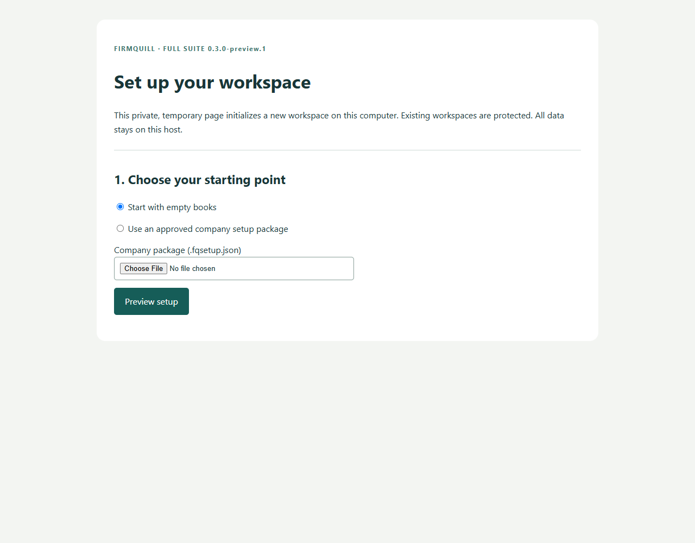
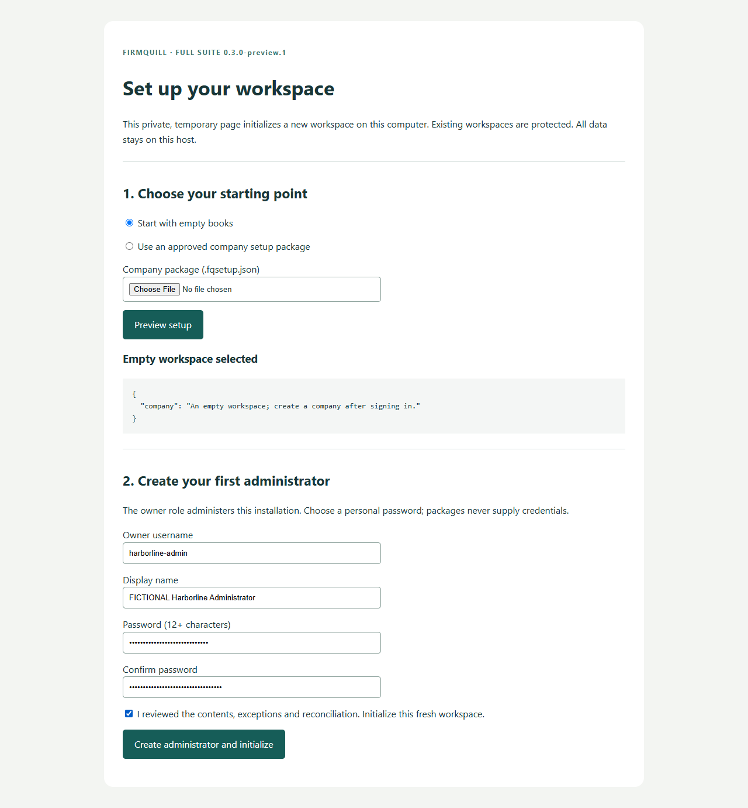
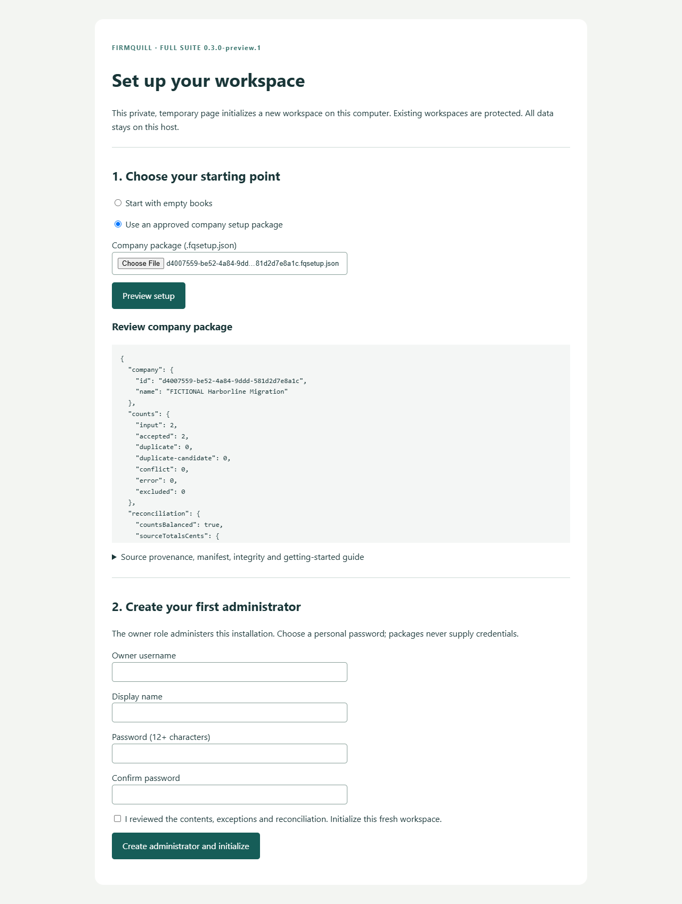
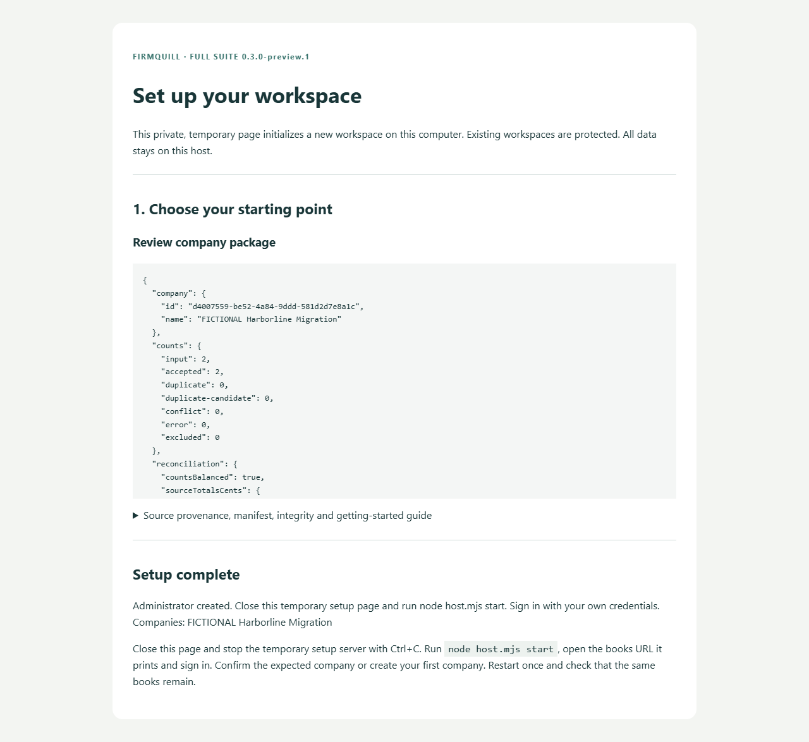
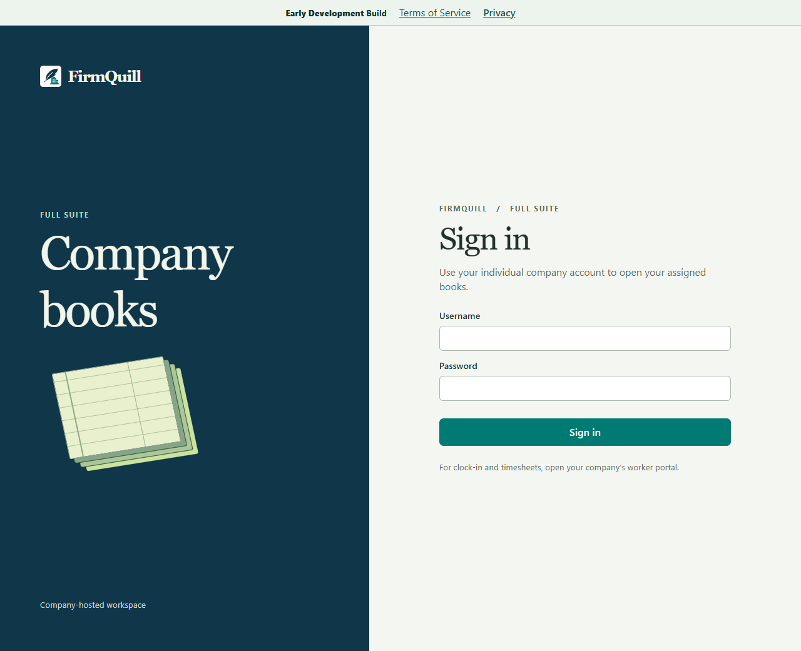
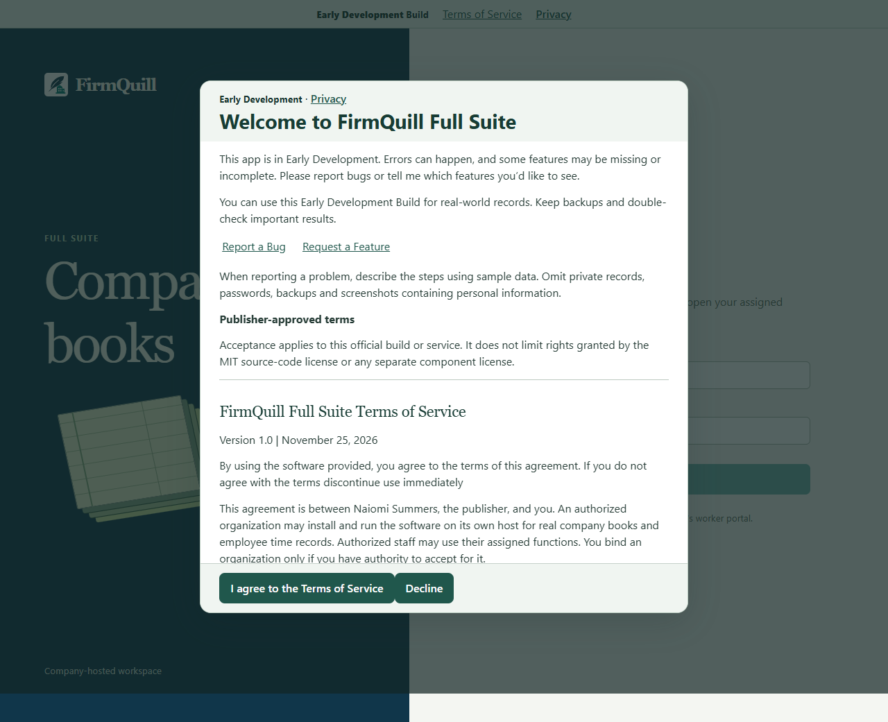
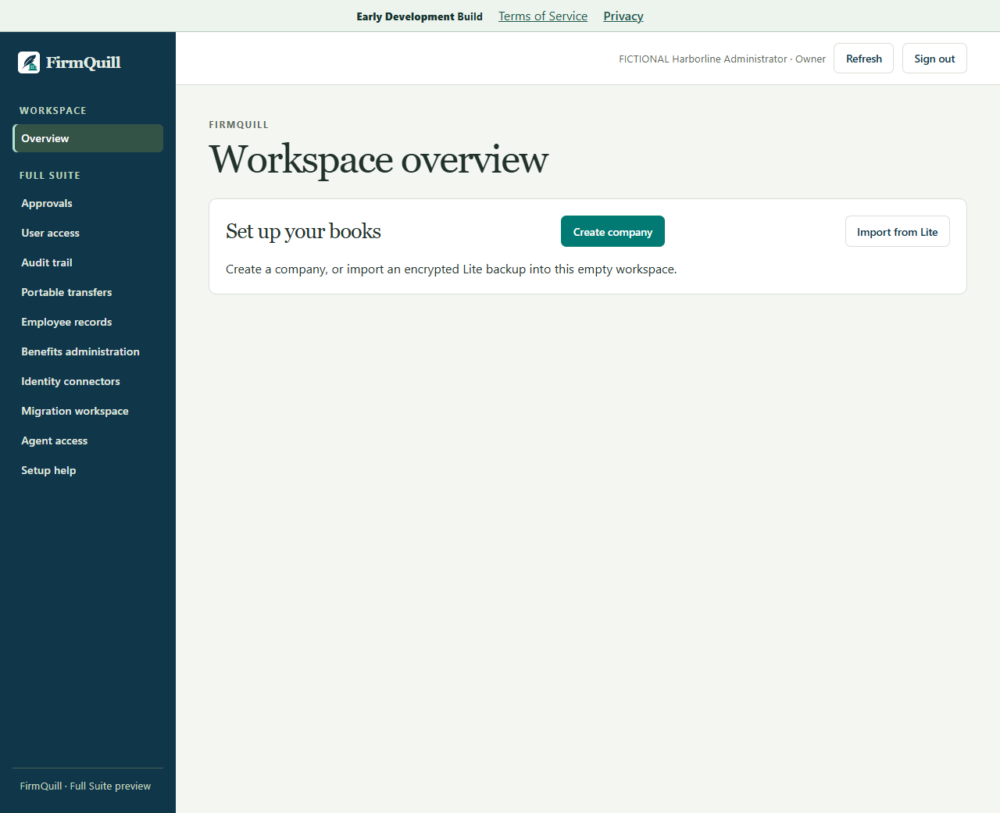
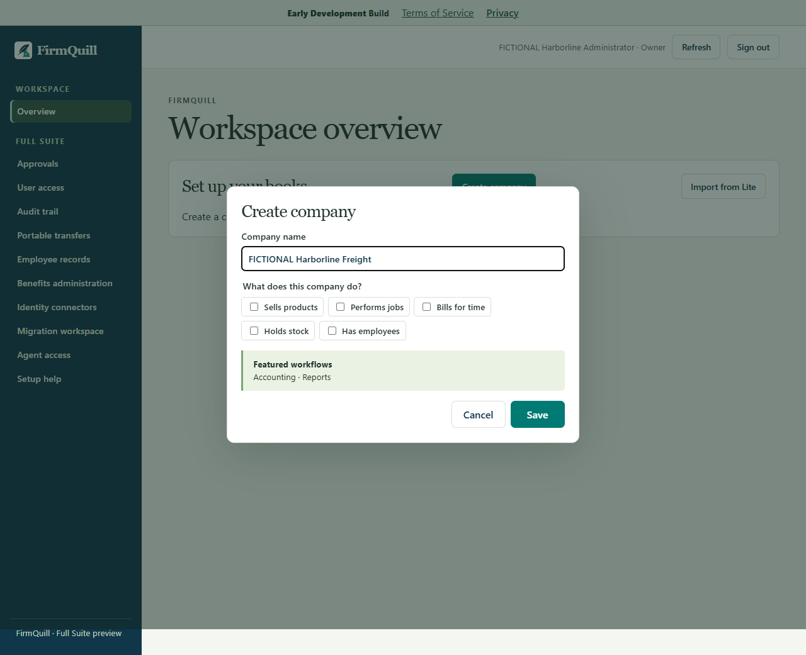
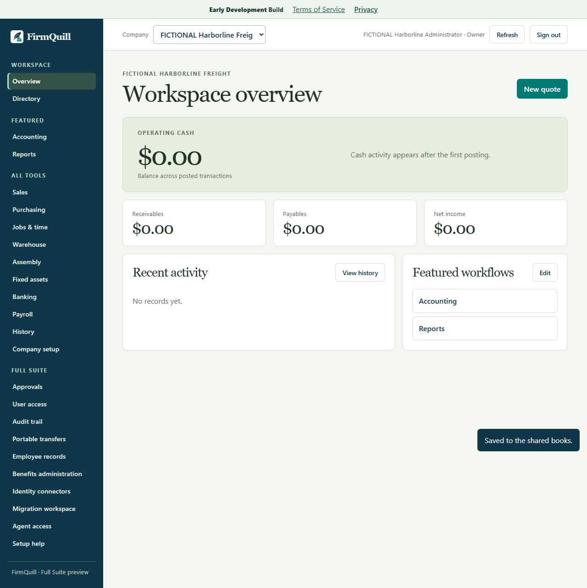
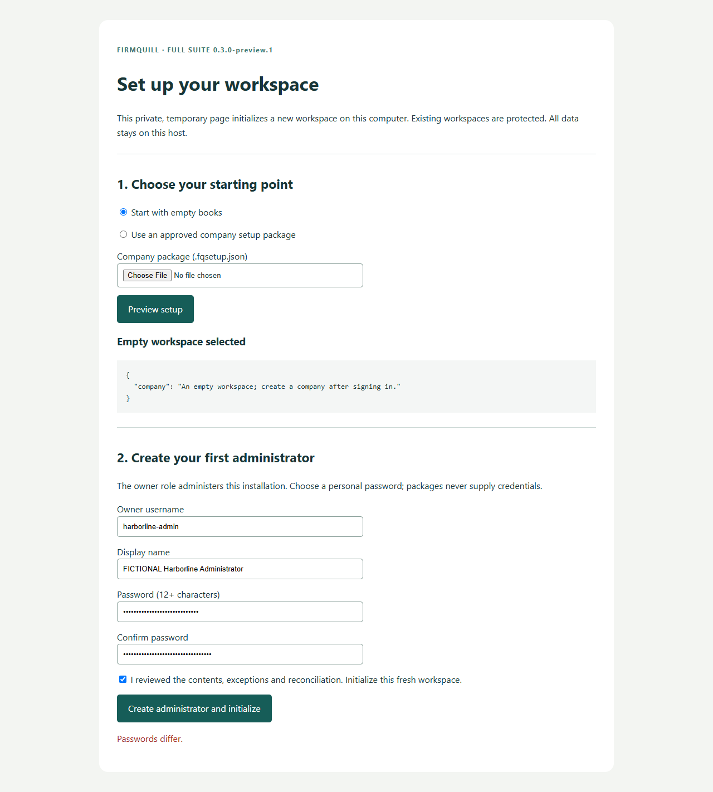

# FirmQuill Full Suite setup guide

Version 0.6.5 · November 26, 2026

This public guide covers installation and first launch. All screenshots show fictional Harborline records in the running local application. The customer feature manual and company-specific migration handoff are delivered separately. No AI account or documentation subscription is required.

## Install and choose the data location

1. Install a compatible Node.js 24 runtime with `node.exe` on PATH. This release was tested with Node 24.22.3. Obtain Node from https://nodejs.org/en/download. Open PowerShell and run `node --version`.
2. Extract the entire Full Suite ZIP to a writable folder. Keep its files together. Do not extract over a running installation. Existing users should retain a separate protected database backup before switching application folders.
3. Open PowerShell in the extracted application folder. The default database is `FirmQuill-data\books.sqlite` in a sibling folder next to the application. Existing installations continue using their existing database. To choose another location, set an absolute path outside the program folder:

```powershell
$env:FIRMQUILL_DB='C:\FirmQuill-private\data\books.sqlite'
```

Protect the data folder with Windows access permissions. Customer setup packages contain private, unencrypted company data; keep them outside the application, source checkout and public download folders. A checksum verifies integrity, not the identity of the preparer. Accept a package only from your agreed migration contact.

## First launch in the browser

For a fresh database filename, run:

```powershell
node host.mjs configure
```

Open the private loopback URL printed by the terminal on this computer. It expires after 30 minutes. Keep that temporary link private. The wizard refuses any existing database and never changes it.



Figure 1. The actual first-launch page starts with empty books selected.

1. Choose **Start with empty books**, or **Use an approved company setup package** and select the privately delivered `.fqsetup.json` file (maximum 16 MiB).
2. Click **Preview setup**. For a package, check the company, source provenance, mapped scope, counts, balances, exceptions and customer getting-started guide. Scroll the preview and inspect the manifest. Ask the preparer to resolve unexpected results before continuing. Contents are treated as data; FirmQuill executes no instructions from a package.
3. In **Create your first administrator**, choose an owner username, display name, a personal password of at least 12 characters and the same password again. The owner is the first administrator. No credentials come from the company package.
4. Check the review confirmation and click **Create administrator and initialize**. FirmQuill prepares and validates a temporary SQLite database, then publishes it without overwriting an existing destination. A validation failure leaves the destination available for retry.



Figure 2. Create a personal administrator account after previewing the chosen starting point.



Figure 3. The package branch shows the company and validated package contents before confirmation.



Figure 4. Setup completion confirms the fresh workspace; the package is not applied again on restart.

After **Setup complete**, close the setup page and press Ctrl+C in its terminal. Start the normal host:

```powershell
node host.mjs start
```

The existing **Start FirmQuill Full.cmd** launcher also starts the normal host. Leave the host terminal open while using the app. Default URLs are `http://127.0.0.1:4179/` for books and `http://127.0.0.1:4180/` for the employee portal.

## Sign in and initialize empty books

1. Open the books URL and sign in with your own administrator account.
2. Read the current Terms of Service and choose whether to accept. Declining leaves the books gated. Acceptance applies to the displayed version and content; it does not replace the source-code license.
3. With empty books, click **Create company**, enter the company name, select activities as appropriate and save. If a company package was initialized, the migrated company is already present; check it instead of creating it again.



Figure 5. Use the credentials you chose; the application has no preset administrator password.



Figure 6. Review the current agreement before accessing the workspace.



Figure 7. A successful empty setup is ready for its first company.



Figure 8. Enter the first company only when the workspace is empty.

## Confirm setup worked

- Confirm the expected company appears in the company picker. For a package, compare the approved migration counts, balances and unresolved-items report with your separate handoff. Do not treat a balanced trial balance alone as proof of migration completeness.
- Refresh the page. Stop the normal host with Ctrl+C, restart it and sign in again. Confirm the same company and records remain. Reopening an initialized database never reapplies the package.
- Check that the worker URL opens its sign-in page. Worker accounts and enabled employee features are configured after setup through the customer's separate feature manual.
- **Setup help** searches only this public guide. It cites the installed version and article. Missing feature guidance is escalated to your designated company support contact. Local setup search has no company-data access and sends nothing to an external provider.



Figure 9. The first company is present in the normal books workspace.

## Terminal alternative and package discovery

Normal `node host.mjs start` still creates the first owner at the terminal when needed. Password entry is hidden. For package setup, preview and confirm explicitly:

```powershell
node host.mjs setup-preview 'C:\FirmQuill-private\company.fqsetup.json'
node host.mjs setup 'C:\FirmQuill-private\company.fqsetup.json'
node host.mjs start
```

The `setup` command prints the preview, requires the literal word `INITIALIZE`, initializes the fresh database, creates the owner at the terminal and exits. Run `start` afterward. For discovery, put a safely named `.fqsetup.json` file in `FirmQuill-setup`, a sibling of the database directory. With the default database, this is a sibling of the application folder. Fresh `start` or `init` lists those packages and offers a number or Enter for empty setup. Existing databases skip discovery entirely.

## Common setup failures and safe retry

| Symptom | Diagnosis and safe next action |
| --- | --- |
| Node not found or SQLite unavailable | Check `node --version`, install the tested Node 24 runtime and reopen the terminal. Do not replace the database. |
| Existing destination / configure refused | The selected database already exists. Start it normally, or set a different fresh absolute `FIRMQUILL_DB` path. Never delete an existing database just to satisfy setup. |
| Database inside program folder | Choose a protected data folder outside the extracted application. |
| Package filename, schema, size, integrity or reference error | Retain the original export and package. Request a corrected package from the preparer. No partial destination is promoted. Preview the corrected file again before retrying. |
| Passwords differ or username invalid | Correct the fields and submit again. Username uses 2–80 lowercase letters/digits and permitted `.`, `_`, `@`, `-` characters; start with a letter or digit. |
| Setup link expired, lost on reload or access denied | Stop the temporary wizard. If setup has not completed, run `configure` again and use its new private URL. After completion, run normal `start`. |
| Address already in use | Stop another test host, or set distinct `FIRMQUILL_MAIN_PORT` and `FIRMQUILL_WORKER_PORT` values before `start`. Use the URLs printed by that host. |
| Cannot sign in | Verify the books URL and the individual administrator username/password. Worker and ERP logins are separate. A package never supplies login credentials. Ask the host administrator about recovery; do not make another copy over the database. |
| Terms prompt appears again | Review the displayed version. Agreement content or account may differ. Do not bypass the prompt. |
| Unexpected company, count, balance or exception | Stop onboarding and contact the migration preparer with the installed version and redacted discrepancy. Keep the working database and original package intact. |
| Host unreachable | Check the terminal is running and use its exact loopback URL. No web hosting is created by this local setup. |



Figure 10. A failed validation leaves the setup form available for correction.

For escalation, contact the company owner or designated FirmQuill support contact. Include version `0.6.5`, the setup article/step, exact error and safe reproduction steps. Omit passwords, setup links, credentials, private exports and screenshots containing real personnel or financial data.
